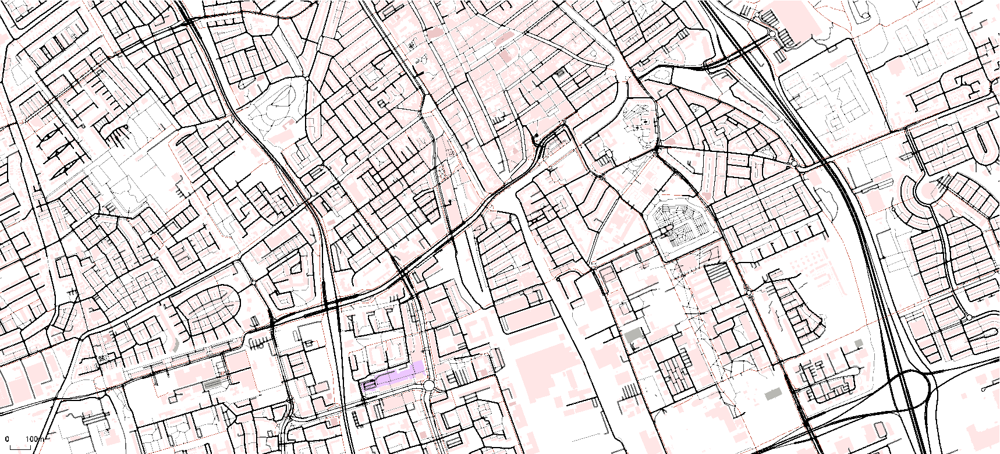

# Welcome to the TUD-SUMO Wiki!



<p align="center">
  <a href="https://pypi.org/project/tud-sumo/">
    
  </a>
  <a href="https://github.com/DAIMoNDLab/tud-sumo">
    
  </a>
  <a href="https://github.com/DAIMoNDLab/tud-sumo/blob/main/LICENSE">
      
  </a>
</p>
<p align="center">
  
  <a href="https://github.com/DAIMoNDLab/tud-sumo/commits/main/">
    
  </a>
</p>

This is the documentation for the TUD-SUMO package, a research-oriented wrapper for SUMO<sup>[1]</sup>, developed for the DAIMoND lab at the Technische Universiteit Delft (TUD), the Netherlands. 

The main goal of TUD-SUMO is to act as a simplified framework for microscopic traffic simulation that allows researchers and students to focus on the important aspects of their projects; **their own work**, instead of simulation code. TUD-SUMO provides an easy and standardised way to simulate a wide range of scenarios whilst facilitating complex interactions. Resulting data can then be saved, summarised and visualised with minimal code.

More information on "Simulation of Urban MObility" (SUMO) can be found in the SUMO documentation, here: [sumo.dlr.de/docs/](https://sumo.dlr.de/docs/)

The main features of TUD-SUMO include:

  - Automatic and standardised data collection.
  - Simplified interface to interact with and control the simulation in complex ways.
  - Traffic signal control logic.
  - Extendable controllers already implemented (ramp metering, route guidance and variable speed limits).
  - A weather & event system with dynamic or scheduled incidents.
  - Plotting functions for a wide range of applications.
  - Videos for recording the network or specific vehicles during the simulation.
  - And _more in the future! ..._


## Links

1. Simulation of Urban MObility (SUMO) documentation: [sumo.dlr.de/docs](https://sumo.dlr.de/docs/)
2. TUD-SUMO source code (GitHub): [DAIMoNDLab/tud-sumo](https://github.com/DAIMoNDLab/tud-sumo)
3. TUD-SUMO PyPI distribution: [project/tud-sumo](https://pypi.org/project/tud-sumo/)
4. TUD-SUMO example (GitHub): [DAIMoNDLab/tud-sumo-examples](https://github.com/DAIMoNDLab/tud-sumo-examples)
5. TUD-SUMO preprint software publication: [dx.doi.org/10.2139/ssrn.6549528](http://dx.doi.org/10.2139/ssrn.6549528)

## Latest Version

The Latest version of TUD-SUMO is _v3.3.3_, and was released on 10/11/2026. All previous versions and their change notes can be found on [GitHub](https://github.com/DAIMoNDLab/tud-sumo/releases) or [PyPI](https://pypi.org/project/tud-sumo/#history). This documentation was last updated on {{ git.date.strftime("%d/%m/%Y") }}.

The change notes for v3.3.3 are:

### Bug Fixes

  - Fixed `Simulation.remove_vehicle_[in|out]_functions()`.
  - Fixed GUI setting in `Simulation.start()` by correcting command line arguments when passing in files.
  - Fixed AttributeError when saving any active recordings during `Simulation.end()`.
  - Fixed `DemandProfile` AttributeError when creating object.
  - Fixed `DemandProfile.create_route_file()`, now ensuring all variables converted to strings before creating file.
  - Added missing 'max_speed', 'width' and 'imperfection' keys in SUMO attribute mapping.
  - Fixed TypeError  in `Plotter.plot_rm_rate()` when plotting metering rate after only setting rate once.
  - Fixed `Recorder.record_network()` where bounds were discarded when no zoom passed.
  - Fixed ValueError when plotting ungrouped simulations with `MultiPlotter`.

## Using TUD-SUMO

TUD-SUMO is developed in the DAIMoND lab of TU Delft. For any questions or feedback, please contact Callum Evans at <span class="highlight">_c.evans@tudelft.nl_</span>. Bug reports can be created in the GitHub repository: [github.com/DAIMoNDLab/tud-sumo](https://github.com/DAIMoNDLab/tud-sumo/).

If you decide to use TUD-SUMO in your projects, please cite the [SoftwareX paper](https://doi.org/10.1016/j.softx.2026.102745) with the reference information:

```bibtex
@article{evans_tud_sumo_2026,
	title = {TUD-SUMO: A Research-oriented SUMO Wrapper for Traffic Simulation in Python},
	author = {Evans, Callum and Rinaldi, Marco and Taale, Henk and Hoogendoorn, Serge P.},
	shorttitle = {TUD-SUMO},
	doi = {10.1016/j.softx.2026.102745},
	journal = {SoftwareX},
	publisher = {Elsevier},
	volume = {34},
	pages = {102745},
	month = jun,
	year = {2026},
	keywords = {Adaptive Traffic Control, Python, SUMO, Traffic Simulation}
}
```

## Acknowledgements

TUD-SUMO is part of the research under the project "_AI in Network Management_," funded by Rijkswaterstaat, grant agreement nr. 31179439, under the label of ITS Edulab.

## References

  1. "_Microscopic Traffic Simulation using SUMO_"; Pablo Alvarez Lopez, Michael Behrisch, Laura Bieker-Walz, Jakob Erdmann, Yun-Pang Flötteröd, Robert Hilbrich, Leonhard Lücken, Johannes Rummel, Peter Wagner, and Evamarie Wießner. _IEEE Intelligent Transportation Systems Conference (ITSC)_, 2018.